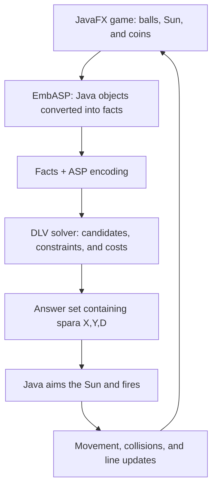

# ZumaAI, a game-playing agent built with Answer Set Programming

ZumaAI adds an automated player to a 2D JavaFX game inspired by Zuma. Its core contribution is **declarative artificial intelligence**: the game state is translated into logical facts, and an ASP solver chooses where to shoot by applying constraints and preferences expressed as rules.

The game handles graphics, movement, collisions, and scoring; the AI chooses the target. The strategy prioritizes combinations that set up chain reactions, followed by matching pairs and then individual balls.

## The game at a glance

A line of red, blue, green, and yellow balls advances along a path toward the Moon. The Sun, at the center of the window, fires colored projectiles: hitting a matching pair or group can eliminate balls; otherwise, the projectile joins the line. Some balls have shields and require an initial hit to weaken them. Coins can also be collected by shooting them.

The goal is to clear the line before it reaches the Moon. The engine also handles groups coming back together and recursively searches for new sequences of at least three matching balls after an impact. This mechanic makes chain reactions valuable to the AI.

## How the AI reasons

Answer Set Programming describes **which choices are allowed and which are preferred** through a logic program. The solver searches for *answer sets*: solutions consistent with the rules and constraints. Penalties guide it toward less costly choices.

In ZumaAI, the strategy is defined manually in the encoding and requires no training or dataset. Each call considers a snapshot of the game and chooses a target; it does not build a complete plan of future moves.



The components divide the work as follows:

| Component | Responsibility |
| --- | --- |
| Java/JavaFX engine | Advances the game and applies the physical effects of shots. |
| EmbASP | Connects Java objects to the ASP program and starts the solver. |
| ASP encoding | Defines candidate targets, obstacles, and strategic preferences. |
| Solver | Computes answer sets for the supplied program. |

## Representing the game state as facts

The encoding uses three input predicates:

| Fact | Meaning |
| --- | --- |
| `ball(X,Y,C,P,S)` | A ball at coordinates `X,Y`, with color `C`, position `P` in the line, and shield state `S`. |
| `sun(C)` | The color of the currently available projectile. |
| `coin(X,Y)` | A coin at coordinates `X,Y`. |

`P` is the zero-based index in the ball list: positions `P` and `P-1` identify consecutive balls even when the path changes direction. `S=1` indicates an active shield; `S=0` means the ball has no active shield, even if it previously had one.

Java converts ball coordinates to integers. Colors come from JavaFX `Color` objects mapped through EmbASP. For readability, the examples below use the symbolic names `red` and `blue` instead: these are illustrative examples, not a transcript of the mapper output.

```prolog
sun(red).
ball(400,611,red,8,0).
ball(432,611,red,9,0).
coin(700,650).
```

Here, the Sun can fire a red projectile, and the line contains a red pair without shields. The program can derive a favorable target on that pair.

## From facts to a target

The main encoding is [`encodings/zuma`](encodings/zuma). Its structure follows four steps: generating candidates, making a choice, excluding forbidden shots, and optimizing.

### 1. Generate candidates

`chosenBall(X,Y,D)` represents a candidate target at coordinates `X,Y`, with strategic cost `D`. Despite its name, the predicate is also used for coins.

This rule recognizes two consecutive balls matching the projectile color, both without shields:

```prolog
chosenBall(X1,Y1,5) :-
    ball(X,Y,C,P,0),
    ball(X1,Y1,C,P-1,0),
    sun(C).
```

It reads: “If two adjacent balls have color `C` and the Sun has that color, consider the second ball's coordinates as a target with cost 5.” In ASP, the part to the right of `:-` states the conditions, and the part to the left states the consequence; `_` denotes a value that does not need a name.

### 2. Express preferences through costs

A lower cost indicates a stronger preference. The encoding uses the following values:

| Recognized situation | Cost | Strategic intention |
| --- | --- | --- |
| A pair matching the current color between two pairs of another color | 3 | Set up four matching balls coming together. |
| A pair matching the current color between one ball and a pair of another color | 4 | Set up three matching balls coming together. |
| A pair matching the current color without shields | 5 | Seek a direct elimination. |
| A pair matching the current color with one or two active shields | 6 | Hit a pair that requires more work. |
| A single ball matching the current color without a shield | 10 | Build a future combination. |
| A single ball matching the current color with a shield | 11 | Fall back to a protected single ball. |
| A coin | 15 | Intended fallback, with the behavior discussed below. |

**Costs are not game scores.** They are heuristic evaluations: the encoding does not calculate exactly how many points a shot will produce. The same target can be derived with different costs, for example as a single ball and as part of a pair.

For a pair where both balls are shielded, the encoding comment says “cost 7,” but the rule assigns **6**. The table reflects the rule's behavior.

### 3. Recognize chain-reaction opportunities

The main strategic contribution is recognizing configurations where removing a central group allows the groups on either side to come together.

With a red projectile, the following configuration produces a candidate with cost 3:

```text
Position:    P-3    P-2    P-1    P      P+1    P+2
Color:       BLUE   BLUE   RED    RED    BLUE   BLUE
                          ^ target

Removing the red pair allows the blue balls to come together:
             BLUE   BLUE   BLUE   BLUE
```

The corresponding rule is:

```prolog
chosenBall(X1,Y1,3) :-
    sun(C),
    ball(_,_,C,P,_),
    ball(X1,Y1,C,P-1,_),
    ball(_,_,C1,P+1,_),
    ball(_,_,C1,P+2,_),
    ball(_,_,C1,P-2,_),
    ball(_,_,C1,P-3,_),
    C != C1.
```

The other two chain rules assign cost 4 when the central pair is surrounded by one ball on one side and two balls on the other, all sharing another color, in either arrangement.

These rules recognize an **opportunity**: they ignore shields and do not simulate the trajectory or impact outcome. Actual elimination and the subsequent chain reaction depend on the game engine.

### 4. Choose, filter, and optimize

For each candidate, the program introduces the choice of whether to shoot:

```prolog
spara(X,Y,D) | notSpara(X,Y,D) :- chosenBall(X,Y,D).

:- #count{X,Y,D: spara(X,Y,D)} < 1.

:~ spara(_,_,D). [D@1]
```

The disjunction generates alternatives. `spara` means “shoot” in Italian; `notSpara` is the predicate representing the alternative of not shooting. The `#count` constraint excludes solutions with no shots. The *weak constraint* `:~` penalizes shots by cost `D`, at priority `1`, favoring less costly solutions.

The constraint requires **at least one shot**: it does not explicitly enforce a maximum of one. The Java program, in turn, retains a single coordinate pair while reading the results and fires one projectile per eligible call.

The encoding also includes geometric constraints to avoid some targets blocked by other sections of the line. For example:

```prolog
:- ball(300,Y2,_,_,_), spara(150,Y1,_), Y2 != 611.
```

This rule forbids shots toward `X=150` when a ball is present on the `X=300` section, subject to the condition on `Y2`. Other constraints cover horizontal sections and the right-hand section. These checks depend on the coordinates of the **1200 × 700** map; they do not provide a general visibility calculation along every trajectory.

### The special case of coins

The program contains this rule:

```prolog
chosenBall(X,Y,15) :-
    coin(X,Y),
    #count{X,Y,D: spara(X,Y,D)} = 0.
```

The comment presents it as a fallback “if there are no shots.” However, the condition counts the `spara` atoms in the solution itself, while another constraint requires at least one. In a valid solution, the count therefore cannot be zero: this formulation alone does not provide a selectable coin fallback. This differs from the strategic intention; the actual Java fallback is described below.

## How Java executes the decision

The game loop calls the AI **every 50 updates**. This frequency is measured in frames, not a fixed interval in seconds.

1. It creates a `DesktopHandler` with `DLVDesktopService("lib/dlv2")` and loads `encodings/zuma` into an `ASPInputProgram`.
2. It adds a snapshot of the balls, the Sun's current color, and the coins. The `@Id` and `@Param` annotations define the mapping between objects and ASP predicates.
3. It runs the solver through `handler.startSync()` and reads the returned answer sets.
4. It uses regular expressions to extract coordinates from `spara(X,Y,D)` atoms and aims the Sun through `dirSun(X,Y)`.
5. If the counter of newly generated balls is greater than 10, it creates the projectile and updates the available color. If no shot was extracted, it uses **`(750,0)`** as the fallback target.

The solver uses the cost to evaluate the choice; Java uses the coordinates to execute it. After the shot, the engine handles collisions, shields, insertions into the line, eliminations, and chain reactions. On the next call, the AI receives the updated state.

## Where the AI contribution lives

| File | Role |
| --- | --- |
| [`encodings/zuma`](encodings/zuma) | ASP strategy: pairs, shields, chains, costs, and target constraints. |
| [`src/zuma/Zuma.java`](graphics-2d-zuma/Zuma/src/zuma/Zuma.java) | Input preparation, solver invocation, decision parsing, and chain handling through `checkQueue`. |
| [`src/sprite/Ball.java`](graphics-2d-zuma/Zuma/src/sprite/Ball.java) | `ball/5` mapping, position in the line, and shield state. |
| [`src/sprite/Sun.java`](graphics-2d-zuma/Zuma/src/sprite/Sun.java) | `sun/1` mapping and automatic aiming. |
| [`src/sprite/Coin.java`](graphics-2d-zuma/Zuma/src/sprite/Coin.java) | `coin/2` mapping. |
| `lib/embasp_3.1.0.jar`, `lib/dlv*` | Integration library and solver executables included in the project. |

The original JavaFX game is in `graphics-2d-zuma/`; its [original README](graphics-2d-zuma/README.md) describes the graphics foundation. Work on the agent focuses on the encoding and the connection between game state and logical decisions.

## Running the project

Clone the repository:

```sh
git clone https://github.com/rimanto98/ZumaAi.git
cd ZumaAi
```

The project is configured for **Java 8** and requires JavaFX. It also needs the EmbASP JAR on the classpath and a solver executable compatible with the operating system. The integration uses the path `lib/dlv2`: having the file in the repository does not guarantee that it will run on your platform.

To run it from an IDE:

1. Import the project root into Eclipse using the included `.project` and `.classpath` files.
2. Configure a JDK with JavaFX and check that `lib/embasp_3.1.0.jar` is included among the dependencies.
3. Check that the `lib/dlv2` binary is compatible with your system and has execution permissions; if using another binary, update the path passed to `DLVDesktopService`.
4. Set the working directory to the repository root so that `encodings/zuma` and `lib/dlv2` resolve correctly.
5. Run the main class, `zuma.Zuma`.

Mouse controls are disabled and the AI controls the Sun. Ant/NetBeans files are available under `graphics-2d-zuma/Zuma/`, but their classpath does not already include EmbASP, so they require additional configuration to run the project.

## Limitations of the implementation

The strategy makes decisions from a snapshot: it does not anticipate target movement during projectile flight or model shots already in flight. It uses the current color, although the game also exposes the next one. Chain preferences rely on local patterns in the line, and blocking constraints depend on the fixed map.

The synchronous solver call also runs inside the JavaFX loop, so reasoning time can affect animation smoothness. Answer-set parsing retains the last coordinates encountered without explicitly selecting among multiple results. These aspects, together with the coin rule and the cost assigned to pairs with two shields, should be considered when modifying or extending the strategy.
